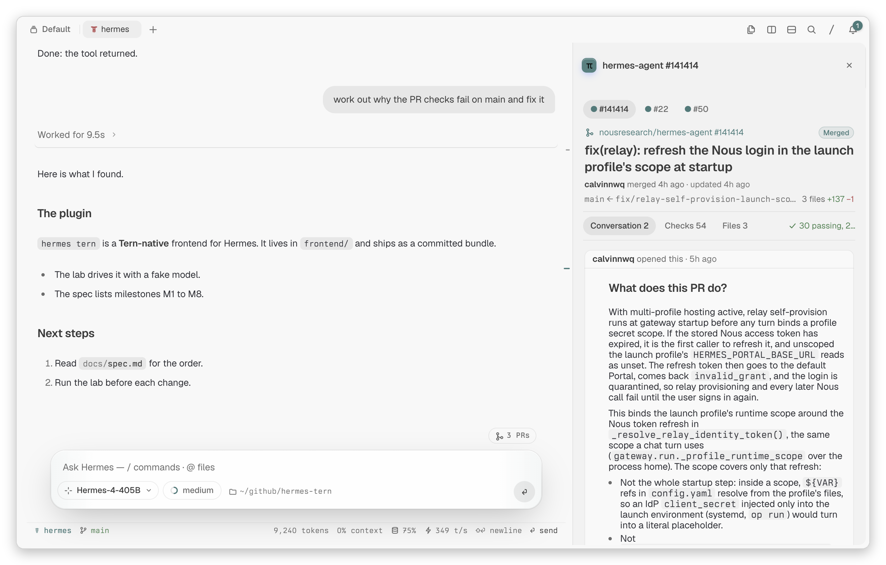
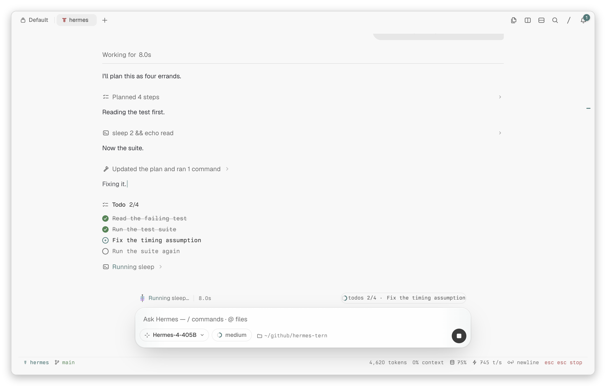
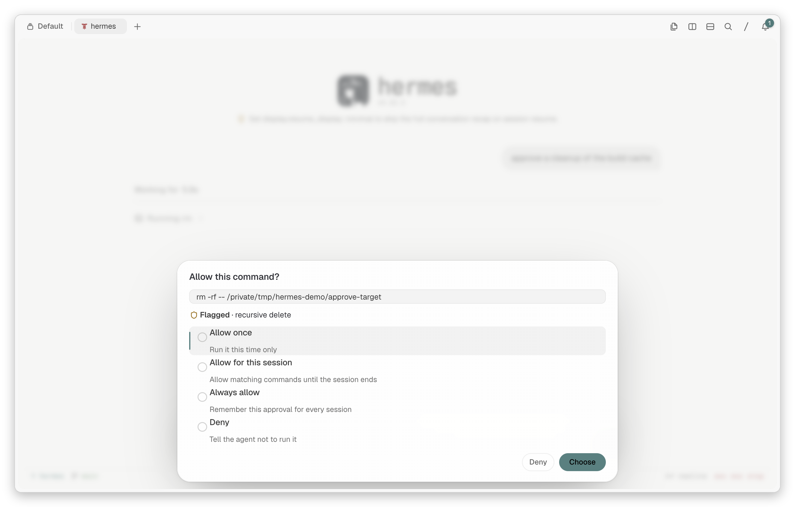
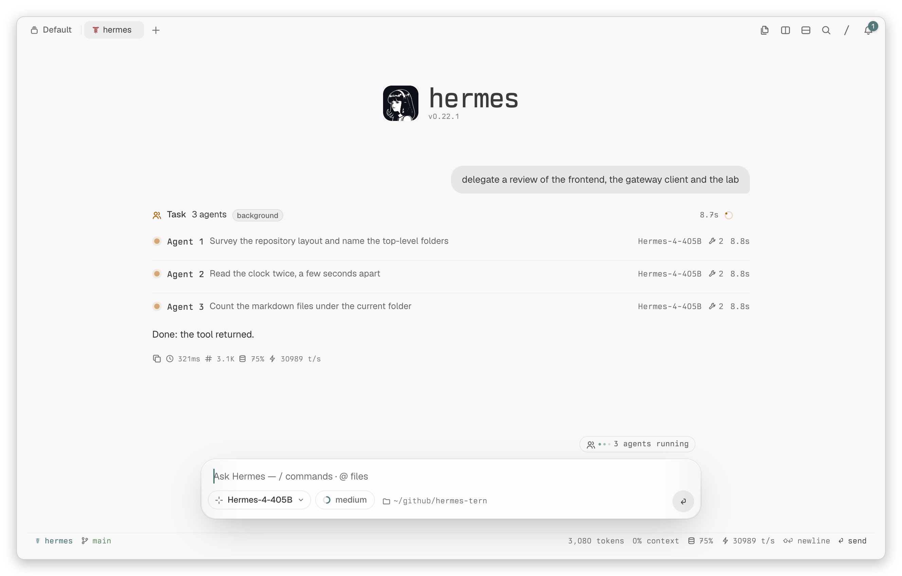
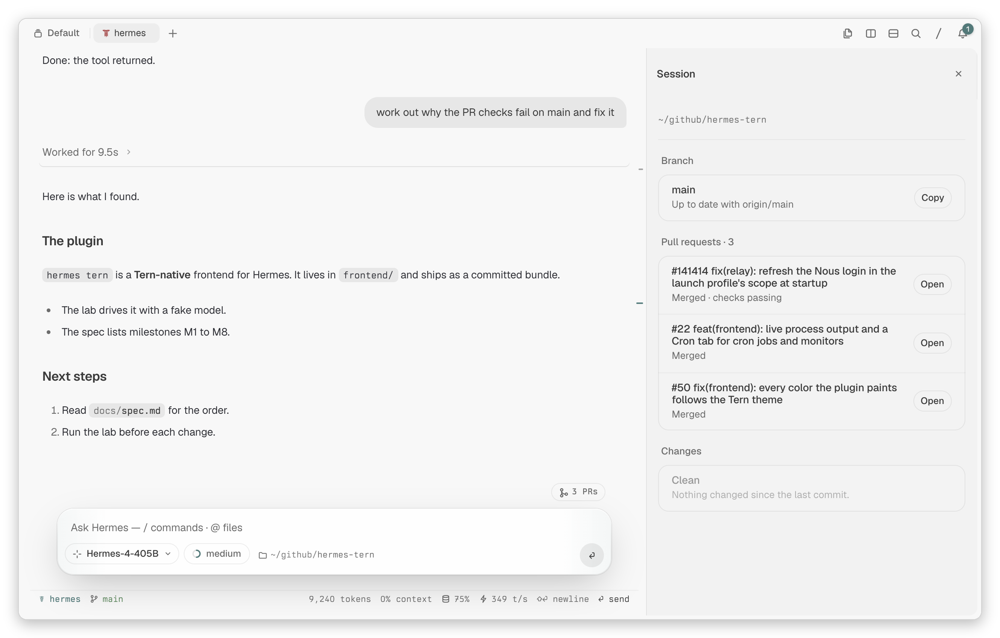
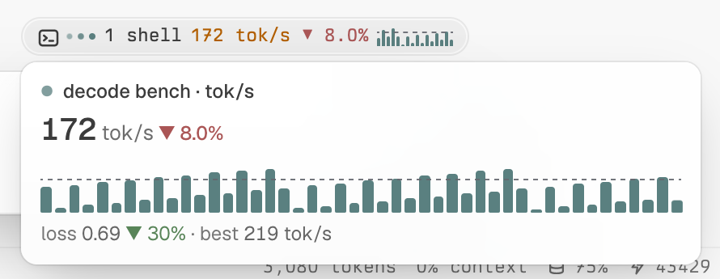
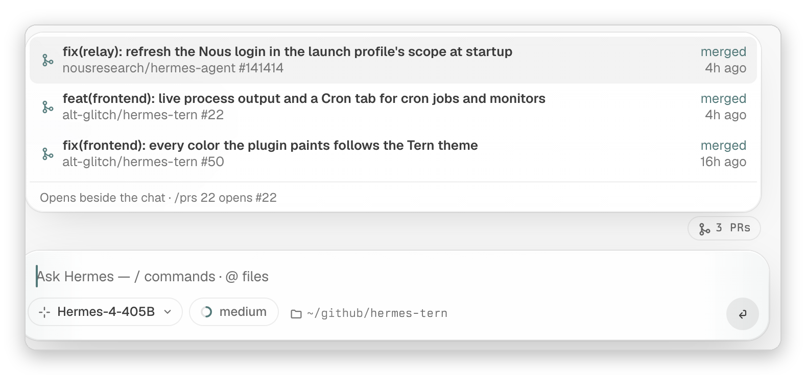
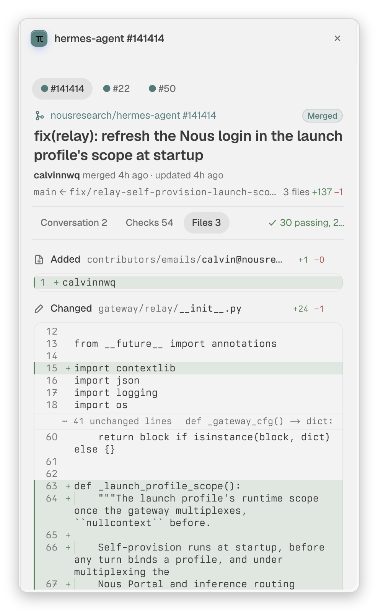
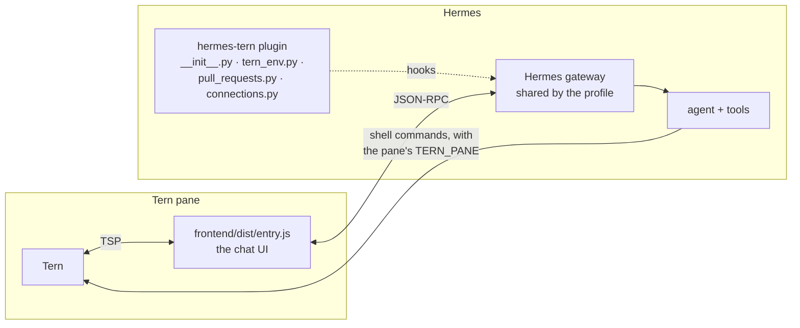

<h1 align="center">hermes-tern</h1>

<p align="center">
  <b><a href="https://github.com/NousResearch/hermes-agent">Hermes Agent</a>, drawn natively by <a href="https://stencil.so/tern">Tern</a>.</b><br>
  The transcript, tool cards, approvals, subagents and pull requests are real Tern UI, not text in a terminal.
</p>

<p align="center">
  <a href="LICENSE"></a>
  
  
</p>

<p align="center">
  <a href="#install">Install</a> ·
  <a href="#the-chat">The chat</a> ·
  <a href="#background-processes">Background processes</a> ·
  <a href="#pull-requests">Pull requests</a> ·
  <a href="#security-and-privacy">Security</a> ·
  <a href="#how-it-works">How it works</a> ·
  <a href="#development">Development</a>
</p>

<p align="center">
  <picture>
    <source media="(prefers-color-scheme: dark)" srcset="docs/images/hero-dark.png">
    
  </picture>
</p>

## Install

```sh
hermes plugins install hermes-tern            # from the plugin catalog, once listed
hermes plugins install alt-glitch/hermes-tern # or from GitHub
```

You need Hermes Agent 0.22.2 or later and [Tern](https://stencil.so/tern). The plugin is built and tested on Tern 0.9.5.

Then, in a Tern pane:

```sh
hermes tern        # the chat, drawn by Tern
hermes tern -c     # every `hermes chat` flag works: -m, -q, --image, --resume, --worktree, …
hermes tern --new  # a new session, where the pane would resume its last one
```

A pane remembers its conversation. If `hermes tern` dies in a pane (a crash, a kill, or a restart of Tern's session daemon), the next `hermes tern` in that pane resumes the conversation and says so. It does this only when you give no session flag, the shell is in the same folder (or the session's folder), and no other live pane shows that conversation. If you quit (Ctrl+D, Ctrl+C twice or `/quit`), the next `hermes tern` starts a new session.

> [!TIP]
> To open Hermes in Tern's agent pane, set `agent_command` in Tern's settings to `hermes tern`.

`hermes tern` describes the chat to Tern over the Tern Surface Protocol (TSP). Tern then draws it with its own components: Markdown, folds, diffs, sheets, asides and keys. If no TSP answer comes back, `hermes tern` starts the regular TUI instead. This happens outside Tern, and inside tmux, screen or zellij.

### What the plugin adds

| | |
| --- | --- |
| `hermes tern` | `hermes chat --tui` with this plugin's Tern frontend; the Ink TUI outside Tern |
| `link_pull_request`, `unlink_pull_request`, `list_pull_requests` | Tools: the PRs a conversation works on, shown above the composer |
| `transform_tool_result` hook | A connector's connect result becomes a card in the chat that started it |
| `tool_request` middleware | The agent's shell commands run with the chat's `TERN_PANE`, so `tern open` works beside the chat |
| `tern_charts` auxiliary task | Writes the rules behind a background process's live chart (`auxiliary.tern_charts` picks its model) |
| System prompt section | Tells the agent to link the PRs it opens |

## The chat

A turn shows what the agent does while it works: its reasoning, short notes, and its tool calls, grouped into one line per run ("Ran 3 commands"). A todo list stays live in the transcript and in the status line. When the turn ends, the work folds into "Worked for 9.5s", and the answer stays in view.

<table>
  <tr>
    <td width="50%"></td>
    <td width="50%"></td>
  </tr>
  <tr>
    <td><b>Live work.</b> Tool runs fold to one line, and the todo list ticks as it goes.</td>
    <td><b>Approvals.</b> A flagged command asks first. There is one button for each answer, and long commands wrap.</td>
  </tr>
  <tr>
    <td></td>
    <td></td>
  </tr>
  <tr>
    <td><b>Subagents.</b> A delegated batch is one card, with one row per agent: its model and its tool count.</td>
    <td><b>Sidebar.</b> The branch, the session's pull requests and the changed files.</td>
  </tr>
</table>

### Keys and commands

| Key | Does |
| --- | --- |
| <kbd>Enter</kbd> · <kbd>Shift</kbd>+<kbd>Enter</kbd> | Send · new line |
| <kbd>Alt</kbd>+<kbd>Enter</kbd> | Steer: send into the running turn |
| <kbd>Alt</kbd>+<kbd>↑</kbd> | Edit a queued prompt |
| <kbd>Esc</kbd> <kbd>Esc</kbd> · <kbd>Ctrl</kbd>+<kbd>C</kbd> | Stop the turn |
| <kbd>Shift</kbd>+<kbd>Tab</kbd> | Reasoning effort |
| <kbd>Alt</kbd>+<kbd>S</kbd> · <kbd>Alt</kbd>+<kbd>P</kbd> · <kbd>Alt</kbd>+<kbd>J</kbd> · <kbd>Alt</kbd>+<kbd>A</kbd> | Sidebar · pull requests · background processes · subagents |
| <kbd>Ctrl</kbd>+<kbd>V</kbd> | Paste an image |

| Command | Does |
| --- | --- |
| `/model`, `/effort` | Pick the model and the reasoning effort (also the chips on the composer) |
| `/sessions` | Search and resume a session from this project, or from any folder. <kbd>→</kbd> browses the selected conversation; <kbd>Alt</kbd>+<kbd>C</kbd> copies its id |
| `/ps` | Background processes and cron jobs |
| `/agents` | Subagents |
| `/changes` | The working tree's diff |
| `/prs [N]` | Pull requests, or PR #N |
| `/theme` | Paint the chat in Tern's colors, Nous colors or the Hermes skin |

## Background processes

The agent can run a command in the background (`terminal(background=true)`). Such a command gets a live chart, as in omp.

1. After 15 s of output, Hermes' auxiliary model reads the command and samples of its output, once. It writes rules that pull numbers out of each line: throughput, latency, loss, tests passed, or progress toward a total that the command states. If nothing is worth charting, it declines.
2. From then on, the plugin applies the rules to each new line itself. It makes no more model calls.
3. A command that writes its output to a log file (`> /tmp/run.log 2>&1`, `| tee run.log`) is charted from that file.
4. After a decline, the plugin asks again when the output has doubled. A job often prints setup lines first and its numbers later.

<p align="center"></p>

| Where | What it shows |
| --- | --- |
| The shells pill | The newest figure and a mini chart. Hover over it to see a tile for each running process. |
| The background terminal card | The primary chart, under the process's live line |
| A `process_manage` wait or poll | The process's tile, in view while the agent waits |
| The Background sheet (`/ps`, <kbd>Alt</kbd>+<kbd>J</kbd>) | The whole chart, above the output |

Goals that the command states draw as dashed lines. The plugin keeps each process's rules in `$HERMES_HOME/plugin-data/hermes-tern/charts/`. So another pane on the session, or a resumed session, charts the process without a new model call.

- **Model:** `auxiliary.tern_charts` in `config.yaml` (or Hermes' model picker) chooses the model. Use a cheap one.
- **Secrets:** Hermes redacts secrets in the samples before they leave.
- **Turn charts off:** set `"jobCharts": false` in `$HERMES_HOME/hermes-tern/settings.json`.

## Pull requests

The agent links every PR that it opens or works on, as T3 Code does. The pill above the composer counts them. Click it (or press <kbd>Alt</kbd>+<kbd>P</kbd>) to open a tray with each PR's state and age.

<p align="center"></p>

Pick a PR, and it docks at the chat's right edge, beside the conversation. The chat gets narrower but keeps the keys, so you can continue to talk to the agent while the PR stays in view. `/prs 22` opens #22 directly.

<table>
  <tr>
    <td width="42%"></td>
    <td>

**Drawn as GitHub draws it.** PR bodies and comments go through the same pipeline as T3 Code's PR panel (`remark-gfm`, `rehype-raw`, GitHub's sanitize schema). `<details>` become folds, bot badges become links, and HTML comments are removed. Tables, task lists, alerts and mermaid diagrams draw natively. `#123` and `@login` are links.

**Three tabs, as on GitHub.**

- **Conversation:** the description, then every comment, review, review thread and commit, in order.
- **Checks:** failing and running checks are open; passed and skipped checks are folded.
- **Files:** each file is Tern's own edit card with its diff, highlighted, and folded around the hunks.

**Actions.** Merge and close (both ask first), mark ready for review, update the branch, re-run failed jobs, copy `gh pr checkout N`, and open on GitHub.

The aside is as wide as Tern's Settings sheet. To resize it, drag that sheet's edge (<kbd>⌘</kbd>+<kbd>,</kbd>).

</td>
  </tr>
</table>

The links are kept for each conversation in `$HERMES_HOME/plugin-data/hermes-tern/pull-requests.json`, so they survive compression and resume. The list also shows two kinds of PR that the agent did not link:

- the PR of the session's branch;
- the other layers of a GitHub stack that a listed PR is part of.

The plugin reads PRs from GitHub with your own token, which Hermes provides. Set it once:

```sh
hermes config set GITHUB_TOKEN "$(gh auth token)"
```

The plugin never reads another tool's login.

## Security and privacy

This section lists what the plugin does beyond drawing the chat, so you can decide before you install it.

| | |
| --- | --- |
| **Network** | GitHub's API, with the token that Hermes gives it (`GITHUB_TOKEN`). It is used for the pull request view and for the actions you click; merge and close ask first. The job charts send the command and samples of a background process's output to your own auxiliary model (`auxiliary.tern_charts`), once per process, after Hermes redacts them. Nothing else. **No telemetry.** |
| **Commands** | A `tool_request` middleware adds `export TERN_PANE=…` (the chat's Tern pane) before the agent's shell commands, in sessions that a Tern pane shows. Approvals and guards see the command as it runs. `!cmd` and `{!cmd}` in the composer run through Hermes' own `shell.exec`, so its dangerous-command refusal applies. They run only when you type them: a pasted `{!cmd}` never runs. The composer's `/` commands are Hermes' own. |
| **Processes** | `hermes tern` runs `hermes chat --tui` in the same process. The chart helper (`widget_author.py`) runs in Hermes' interpreter for one model request, then exits. Opening the sidebar, or a file beside the chat, runs Tern's own `tern` CLI. |
| **Reads outside its data** | Hermes' session database, read-only: a conversation's compression lineage and its subagents' parents. The output of the session's background processes, and the log files that their commands write to (for charts). The files you open from the chat. |
| **Stored data** | `$HERMES_HOME/plugin-data/hermes-tern/`: linked pull requests, which panes show which sessions (with their Tern variables), chart rules and connect cards. `$HERMES_HOME/hermes-tern/settings.json`: the theme and chart settings. |

## How it works



- **`__init__.py`** registers `hermes tern`. It runs `hermes chat --tui <flags>` with `HERMES_TUI_DIR` pointing at `frontend/`, so Hermes' own launcher still handles the profile, the working folder, resume, worktrees, the gateway attach and the exit summary. Exit code 75 (no TSP) reruns `hermes chat --tui` without the plugin's frontend. In a Tern pane whose last chat died, **`panes.py`** adds `--resume <root id>` to the flags: the frontend records each pane's conversation in `$HERMES_HOME/plugin-data/hermes-tern/panes/<TERN_PANE>.json`, because Tern's daemon restarts only omp after a crash.
- **`frontend/`** is the TSP frontend: a TypeScript app on [`@stencil-hq/tern`](https://www.npmjs.com/package/@stencil-hq/tern). It talks to the profile's shared Hermes gateway (`hermes-gateway-v1`) through Hermes' own gateway client. `frontend/dist/entry.js` is committed, so an install needs no build step. CI builds it on `main` after each merge (`.github/workflows/bundle.yml`); pull requests carry source only. [`frontend/README.md`](frontend/README.md) maps its modules.
- **`tern_env.py`** is needed because the agent's tools run in that shared gateway, not in the chat's pane. This `tool_request` middleware puts an `export` of the pane's `TERN_PANE` and window variables before each shell command that the agent runs: in the foreground, in the background, and from a Python cell. It reads them from the pane's marker when the call is made. The model's history keeps the command as the model wrote it, and the frontend leaves the prefix out of what it shows. So plain `tern open`, `tern split` and the rest of Tern's CLI act beside the chat. [`docs/tern-blocks.md`](docs/tern-blocks.md) is a short guide to scripting blocks that way: split, run, capture, wait and close.
- **`widget_author.py`** runs in Hermes' interpreter when the frontend asks for a background process's chart rules. It calls the auxiliary model (task `tern_charts`) and prints the answer. The frontend validates the rules and runs them (`frontend/src/processes/widgets/`, ported from omp's job widgets). It uses Node's linear-time regex engine, so no rule can stall the chat.

> [!NOTE]
> **Compatibility.** The bundle inlines Hermes' renderer-free ui-tui modules (the gateway client and skins) and `apps/shared`, from the Hermes commit in `frontend/hermes-src.lock`. At run time it runs that client against the installed Hermes, which starts the gateway through `ui-tui/scripts/gateway_bootstrap.py`. That script and the gateway's wire format are Hermes internals: when they change, rebuild against the newer Hermes.

## Development

```sh
hermes plugins validate .                         # the catalog's admission checks
uv run --with pytest pytest -q                    # the Python side (no Hermes checkout needed)

cd frontend
HERMES_SRC=~/path/to/hermes-agent bun run setup   # links .hermes-src, installs (bun)
bun run check                                     # typecheck, tests, lint, size and strictness ratchets
bun run bundle                                    # rebuilds dist/entry.js for local runs: do not commit it
```

<details>
<summary><b>The lab: drive the UI without credentials</b></summary>

`lab/fake_model.py --home DIR` writes a disposable `HERMES_HOME` that points at a loopback model, and then serves that model. The prompt picks the flow: "approve", "clarify", "tool", "work…", "delegate…", "errands…", "jobchart…", "pr URL…" and more. The file's docstring lists them all. Any other prompt streams Markdown.

Pair the fake model with a headless Tern (`tern serve --control PORT`, then `tern ctl --control PORT run|type|key|shot …`) to check the UI. The screenshots in this README come from that setup.

`lab/chartbench.ts` replays real background jobs (their recorded output and log files) through the chart registry and the auxiliary model, and reports which jobs chart.

</details>

## Credits

The frontend began as [can1357](https://github.com/can1357)'s `ui-tsp` (`can1357/hermes-agent@tern-frontend`). It keeps omp's chat roles (`omp.session`, …), which Tern's chat styles, tool folding and Carly integration are written against. Some UI patterns come from [T3 Code](https://github.com/pingdotgg/t3code).

## License

MIT. See [`LICENSE`](LICENSE).
