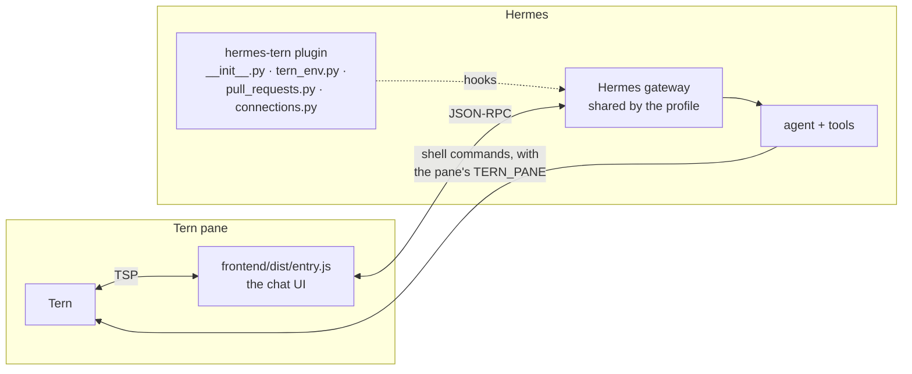

<h1 align="center">hermes-tern</h1>

<p align="center">
  <b><a href="https://github.com/NousResearch/hermes-agent">Hermes Agent</a>, drawn natively by <a href="https://stencil.so/tern">Tern</a>.</b><br>
  The transcript, tool cards, approvals, subagents and pull requests are real Tern UI, not text in a terminal.
</p>

<p align="center">
  <a href="LICENSE"></a>
  
  
</p>

<p align="center">
  <a href="#install">Install</a> ·
  <a href="#the-chat">The chat</a> ·
  <a href="#background-processes">Background processes</a> ·
  <a href="#pull-requests">Pull requests</a> ·
  <a href="#security-and-privacy">Security</a> ·
  <a href="#how-it-works">How it works</a> ·
  <a href="#development">Development</a>
</p>

<p align="center">
  <picture>
    <source media="(prefers-color-scheme: dark)" srcset="docs/images/hero-dark.png">
    
  </picture>
</p>

## Install

```sh
hermes plugins install hermes-tern            # from the plugin catalog, once listed
hermes plugins install alt-glitch/hermes-tern # or from GitHub
```

You need Hermes Agent 0.22.2 or later and [Tern](https://stencil.so/tern). The plugin is built and tested on Tern 0.9.5.

Then, in a Tern pane:

```sh
hermes tern        # the chat, drawn by Tern
hermes tern -c     # every `hermes chat` flag works: -m, -q, --image, --resume, --worktree, …
hermes tern --new  # a new session, where the pane would resume its last one
```

A pane remembers its conversation. If `hermes tern` dies in a pane (a crash, a kill, or a restart of Tern's session daemon), the next `hermes tern` in that pane resumes the conversation and says so. It does this only when you give no session flag, the shell is in the same folder (or the session's folder), and no other live pane shows that conversation. If you quit (Ctrl+D, Ctrl+C twice or `/quit`), the next `hermes tern` starts a new session.

> [!TIP]
> To open Hermes in Tern's agent pane, set `agent_command` in Tern's settings to `hermes tern`.

`hermes tern` describes the chat to Tern over the Tern Surface Protocol (TSP). Tern then draws it with its own components: Markdown, folds, diffs, sheets, asides and keys. If no TSP answer comes back, `hermes tern` starts the regular TUI instead. This happens outside Tern, and inside tmux, screen or zellij.

### What the plugin adds

| | |
| --- | --- |
| `hermes tern` | `hermes chat --tui` with this plugin's Tern frontend; the Ink TUI outside Tern |
| `link_pull_request`, `unlink_pull_request`, `list_pull_requests` | Tools: the PRs a conversation works on, shown above the composer |
| `transform_tool_result` hook | A connector's connect result becomes a card in the chat that started it |
| `tool_request` middleware | The agent's shell commands run with the chat's `TERN_PANE`, so `tern open` works beside the chat |
| `tern_charts` auxiliary task | Writes the rules behind a background process's live chart (`auxiliary.tern_charts` picks its model) |
| System prompt section | Tells the agent to link the PRs it opens |

## The chat

A turn shows what the agent does while it works: its reasoning, short notes, and its tool calls, grouped into one line per run ("Ran 3 commands"). A todo list stays live in the transcript and in the status line. When the turn ends, the work folds into "Worked for 9.5s", and the answer stays in view.

<table>
  <tr>
    <td width="50%"></td>
    <td width="50%"></td>
  </tr>
  <tr>
    <td><b>Live work.</b> Tool runs fold to one line, and the todo list ticks as it goes.</td>
    <td><b>Approvals.</b> A flagged command asks first. There is one button for each answer, and long commands wrap.</td>
  </tr>
  <tr>
    <td></td>
    <td></td>
  </tr>
  <tr>
    <td><b>Subagents.</b> Active Task cards use the same tile frame as background processes. Each frame shows up to four agents, with an overflow action that opens <code>/agents</code>.</td>
    <td><b>Sidebar.</b> The branch, the session's pull requests and the changed files.</td>
  </tr>
</table>

Each active agent tile shows its current tool and its latest two assistant or tool-intent lines, limited to 160 characters per line. Click a tile to open the existing agent view beside the chat, or its timeline sheet when native splitting is unavailable. Hover the dock's agents pill to see the same frame. Pending placeholders without agent events stay as rows. When all agents finish, the Task card returns to result rows.

### Keys and commands

| Key | Does |
| --- | --- |
| <kbd>Enter</kbd> · <kbd>Shift</kbd>+<kbd>Enter</kbd> | Send (queue while busy by default) · new line |
| <kbd>Alt</kbd>+<kbd>Enter</kbd> | Steer a running turn (queue instead when busy mode is `steer`) |
| <kbd>Alt</kbd>+<kbd>↑</kbd> | Edit a queued prompt |
| <kbd>Esc</kbd> <kbd>Esc</kbd> · <kbd>Ctrl</kbd>+<kbd>C</kbd> | Stop the turn |
| <kbd>Shift</kbd>+<kbd>Tab</kbd> | Reasoning effort |
| <kbd>Alt</kbd>+<kbd>S</kbd> · <kbd>Alt</kbd>+<kbd>P</kbd> · <kbd>Alt</kbd>+<kbd>J</kbd> · <kbd>Alt</kbd>+<kbd>A</kbd> | Sidebar · pull requests · background processes · subagents |
| <kbd>Ctrl</kbd>+<kbd>V</kbd> | Paste an image |
| <kbd>Ctrl</kbd>+<kbd>L</kbd> | Start/stop one Hermes Talk realtime conversation; Esc or the visible Stop button also hangs up |

While an agent turn runs, **Enter queues** a follow-up and **Alt+Enter steers** the current turn. Setting `display.busy_input_mode` to `steer` swaps these two actions; native Tern Send follows Enter's mode. An open modal blocks Send without consuming your draft or caret. Typed inline `{!cmd}` commands expand before a correction is steered, but pasted commands remain literal. Failed expansion or rejected steering keeps your editable draft.

| Command | Does |
| --- | --- |
| `/model`, `/effort` | Pick the model and the reasoning effort (also the chips on the composer) |
| `/sessions` | Search and resume a session from this project, or from any folder. <kbd>→</kbd> browses the selected conversation; <kbd>Alt</kbd>+<kbd>C</kbd> copies its id |
| `/ps` | Background processes and cron jobs |
| `/agents` | Subagents |
| `/changes` | The working tree's diff |
| `/prs [N]` | Pull requests, or PR #N |
| `/theme` | Paint the chat in Tern's colors, Nous colors or the Hermes skin |

### Realtime conversation and thinking orb

Enable `hermes-talk` in the same Hermes profile. **Ctrl+L** explicitly starts a duplex call on that machine’s microphone and speaker using Talk’s configured provider/authentication. Press it again, press **Esc**, or click **Stop** to hang up. Alt+Shift+V and `/live` retain a disclosure/Allow flow. No call starts on launch or tab focus.

The existing OMP-derived thinking orb follows the reported conversation phase: listening, thinking, speaking, then normal agent state after hang-up. Hidden panes and reduced-motion retain their existing animation limits. Your draft and caret are not submitted or cleared.

The `tern-talk` plugin command reserves one owner/call before returning, so frontend RPC timeouts cannot create overlapping calls. Stop cancels the owned async task and waits for Talk’s audio/provider teardown; a lost frontend heartbeat also ends the call. Calls made directly with upstream `/talk` are not silently adopted. This adapter uses Talk’s terminal realtime lane; a separately configured GPT-Live lane still requires Talk’s explicit canonical task attachment and is not replaced with STT/TTS.

## Background processes

The agent can run a command in the background (`terminal(background=true)`). Such a command gets a live chart, as in omp.

1. After 15 s of output, Hermes' auxiliary model reads the command and samples of its output, once. It writes rules that pull numbers out of each line: throughput, latency, loss, tests passed, or progress toward a total that the command states. If nothing is worth charting, it declines.
2. From then on, the plugin applies the rules to each new line itself. It makes no more model calls.
3. A command that writes its output to a log file (`> /tmp/run.log 2>&1`, `| tee run.log`) is charted from that file.
4. After a decline, the plugin asks again when the output has doubled. A job often prints setup lines first and its numbers later.

<p align="center"></p>

| Where | What it shows |
| --- | --- |
| The shells pill | The newest figure and a mini chart. Hover over it to see a tile for each running process. |
| The background terminal card | The primary chart, under the process's live line |
| A `process_manage` wait or poll | The process's tile, in view while the agent waits |
| The Background sheet (`/ps`, <kbd>Alt</kbd>+<kbd>J</kbd>) | The whole chart, above the output |

Goals that the command states draw as dashed lines. The plugin keeps each process's rules in `$HERMES_HOME/plugin-data/hermes-tern/charts/`. So another pane on the session, or a resumed session, charts the process without a new model call.

- **Model:** `auxiliary.tern_charts` in `config.yaml` (or Hermes' model picker) chooses the model. Use a cheap one.
- **Secrets:** Hermes redacts secrets in the samples before they leave.
- **Turn charts off:** set `"jobCharts": false` in `$HERMES_HOME/hermes-tern/settings.json`.

## Pull requests

The agent links every PR that it opens or works on, as T3 Code does. The pill above the composer counts them. Click it (or press <kbd>Alt</kbd>+<kbd>P</kbd>) to open a tray with each PR's state and age.

<p align="center"></p>

Pick a PR, and it docks at the chat's right edge, beside the conversation. The chat gets narrower but keeps the keys, so you can continue to talk to the agent while the PR stays in view. `/prs 22` opens #22 directly.

<table>
  <tr>
    <td width="42%"></td>
    <td>

**Drawn as GitHub draws it.** PR bodies and comments go through the same pipeline as T3 Code's PR panel (`remark-gfm`, `rehype-raw`, GitHub's sanitize schema). `<details>` become folds, bot badges become links, and HTML comments are removed. Tables, task lists, alerts and mermaid diagrams draw natively. `#123` and `@login` are links.

**Three tabs, as on GitHub.**

- **Conversation:** the description, then every comment, review, review thread and commit, in order.
- **Checks:** failing and running checks are open; passed and skipped checks are folded.
- **Files:** each file is Tern's own edit card with its diff, highlighted, and folded around the hunks.

**Actions.** Merge and close (both ask first), mark ready for review, update the branch, re-run failed jobs, copy `gh pr checkout N`, and open on GitHub.

The aside is as wide as Tern's Settings sheet. To resize it, drag that sheet's edge (<kbd>⌘</kbd>+<kbd>,</kbd>).

</td>
  </tr>
</table>

The links are kept for each conversation in `$HERMES_HOME/plugin-data/hermes-tern/pull-requests.json`, so they survive compression and resume. The list also shows two kinds of PR that the agent did not link:

- the PR of the session's branch;
- the other layers of a GitHub stack that a listed PR is part of.

The plugin reads PRs from GitHub with your own token, which Hermes provides. Set it once:

```sh
hermes config set GITHUB_TOKEN "$(gh auth token)"
```

The plugin never reads another tool's login.

## Native Settings and Model Hub (stacked preview)

- `/settings` or `/prefs` opens native Tern preferences. `/models` opens Hermes' provider inventory; `/model` still opens the existing live-session model picker. Profile defaults and session model/effort pins are different scopes.
- The preview reads supported, individually normalized Hermes profile keys **only when opened**: busy input mode, approval policy, details (including the supported `hidden` mode), thought display, TUI theme/density/focus and skin. Every pinned Hermes `config.get` / `config.set` / readback carries **both** the captured canonical `session.info.profile_name` and session ID; opening without that canonical identity fails closed, and reaped session IDs never retarget a different connection profile. Writes are serialized per frontend gateway, compare the latest owner-read value against the value the sheet opened with, and verify canonical readback. A security-policy change has a separate confirmation. Native Settings and Model Hub roots are unique per opening even though their logical overlay keys stay stable, so the SDK cannot dispatch stale A-sheet event IDs into a B-sheet successor. Stale/replaced/closed session sheets cannot issue new writes or render late replies.
- This is **not** a full schema-backed Settings API. Pinned Hermes at `22063fc` exposes no `settings.get/set`, `model.hub.get/set`, field schemas, profile revision/CAS, credential-safe redacted readback or native auxiliary-role/fallback mutation contract. Cross-client atomic conflict prevention is not possible: concurrent writes between the optimistic read and set may race; the precheck is **not atomic CAS**. The UI does not invent those methods or claim success without readback. Unsupported fields and provider authentication remain read-only and use Hermes' supported setup flow. Neither `config.get full` nor provider secrets are fetched, and this plugin does not save independent model/profile defaults. Pre-existing `/skin` commands outside these native transactions keep their baseline scoping behavior and are not changed here.
- Settings and Model Hub read nothing at startup, and do not intercept composer input. The existing raw-byte Tern/SDK/App draft path, Unicode, paste provenance, Enter routing and undo are unchanged.

## Security and privacy

This section lists what the plugin does beyond drawing the chat, so you can decide before you install it.

| | |
| --- | --- |
| **Network** | GitHub's API, with the token that Hermes gives it (`GITHUB_TOKEN`). It is used for the pull request view and for the actions you click; merge and close ask first. The job charts send the command and samples of a background process's output to your own auxiliary model (`auxiliary.tern_charts`), once per process, after Hermes redacts them. Nothing else. **No telemetry.** |
| **Commands** | A `tool_request` middleware adds `export TERN_PANE=…` (the chat's Tern pane) before the agent's shell commands, in sessions that a Tern pane shows. Approvals and guards see the command as it runs. `!cmd` and `{!cmd}` in the composer run through Hermes' own `shell.exec`, so its dangerous-command refusal applies. They run only when you type them: a pasted `{!cmd}` never runs. The composer's `/` commands are Hermes' own. |
| **Processes** | `hermes tern` runs `hermes chat --tui` in the same process. The chart helper (`widget_author.py`) runs in Hermes' interpreter for one model request, then exits. Opening the sidebar, or a file beside the chat, runs Tern's own `tern` CLI. |
| **Reads outside its data** | Hermes' session database, read-only: a conversation's compression lineage and its subagents' parents. The output of the session's background processes, and the log files that their commands write to (for charts). The files you open from the chat. |
| **Settings RPCs** | Opening /settings or /models asks the active Hermes gateway for individual normalized preferences or public provider names/counts. Supported profile writes go through Hermes' config.set and a post-write config.get; security-policy changes require explicit confirmation. This plugin does not read full expanded profile config, provider secrets, or write profile values to hermes-tern/settings.json. |
| **Stored data** | `$HERMES_HOME/plugin-data/hermes-tern/`: linked pull requests, which panes show which sessions (with their Tern variables), chart rules and connect cards. `$HERMES_HOME/hermes-tern/settings.json`: the theme and chart settings. |

## How it works



- **`__init__.py`** registers `hermes tern`. It runs `hermes chat --tui <flags>` with `HERMES_TUI_DIR` pointing at `frontend/`, so Hermes' own launcher still handles the profile, the working folder, resume, worktrees, the gateway attach and the exit summary. Exit code 75 (no TSP) reruns `hermes chat --tui` without the plugin's frontend. In a Tern pane whose last chat died, **`panes.py`** adds `--resume <root id>` to the flags: the frontend records each pane's conversation in `$HERMES_HOME/plugin-data/hermes-tern/panes/<TERN_PANE>.json`, because Tern's daemon restarts only omp after a crash.
- **`frontend/`** is the TSP frontend: a TypeScript app on [`@stencil-hq/tern`](https://www.npmjs.com/package/@stencil-hq/tern). It talks to the profile's shared Hermes gateway (`hermes-gateway-v1`) through Hermes' own gateway client. `frontend/dist/entry.js` is committed, so an install needs no build step. CI builds it on `main` after each merge (`.github/workflows/bundle.yml`); pull requests carry source only. [`frontend/README.md`](frontend/README.md) maps its modules.
- **`tern_env.py`** is needed because the agent's tools run in that shared gateway, not in the chat's pane. This `tool_request` middleware puts an `export` of the pane's `TERN_PANE` and window variables before each shell command that the agent runs: in the foreground, in the background, and from a Python cell. It reads them from the pane's marker when the call is made. The model's history keeps the command as the model wrote it, and the frontend leaves the prefix out of what it shows. So plain `tern open`, `tern split` and the rest of Tern's CLI act beside the chat. [`docs/tern-blocks.md`](docs/tern-blocks.md) is a short guide to scripting blocks that way: split, run, capture, wait and close.
- **`widget_author.py`** runs in Hermes' interpreter when the frontend asks for a background process's chart rules. It calls the auxiliary model (task `tern_charts`) and prints the answer. The frontend validates the rules and runs them (`frontend/src/processes/widgets/`, ported from omp's job widgets). It uses Node's linear-time regex engine, so no rule can stall the chat.

> [!NOTE]
> **Compatibility.** The bundle inlines Hermes' renderer-free ui-tui modules (the gateway client and skins) and `apps/shared`, from the Hermes commit in `frontend/hermes-src.lock`. At run time it runs that client against the installed Hermes, which starts the gateway through `ui-tui/scripts/gateway_bootstrap.py`. That script and the gateway's wire format are Hermes internals: when they change, rebuild against the newer Hermes.

### Optional read-only gateway reports

On Hermes builds exposing public session-attached plugin gateway methods
(the downstream [gateway seam PR #650](https://github.com/kvnloo/hermes-agent/pull/650)),
`hermes-tern.operations.report` returns real profile-scoped read-only MCP
configuration, cached status and catalog listings. It never connects,
authenticates, installs, reloads, probes or returns secrets. MCP cached
tool-name and effective SSH target views remain explicitly **unavailable**
pending public owned readers.

The native `/btw` sheet retains unsent side questions and reports
**Needs Hermes plugin gateway methods** on older Hermes versions. Persistent
BTW submit/list/cancel is **not activated**: the public plugin gateway
request has a live RPC SID, not an authenticated durable conversation
identity, state.db metadata handle or parent provider snapshot.
No private server records, second store, alternate RPC path or runtime
pin changes are used. See
[compatibility and authority details](frontend/docs/btw-operational-sheets.md).

## Exit-75 fallback qualification (downstream, opt-in)

The production path remains **one launcher**: hermes tern calls Hermes'
chat --tui with HERMES_TUI_DIR=frontend/; the **real compiled** Tern entry asks
for TSP. Only exit **75** retries Hermes' ordinary **Ink** TUI, with the same
CLI flags and pane-launch environment. Other exits propagate. HERMES_TERN=0
(or false, off, no) deliberately uses Ink without starting the TSP entry.

Two distinct regression levels are retained:

- Default Python tests (tests/test_launcher.py and tests/test_panes.py)
  verify launcher policy, profile/pane context, argv, exact-once retry, opt-out
  and existing dead-pane ownership. The lightweight policy tests record a
  *simulated* return code. They do **not** qualify a frontend handshake.
- Explicit tests/test_fallback_native.py uses **actual** frontend/dist/entry.js,
  a real PTY and non-TTY subprocess, the plugin's real _run/_chat into the
  pinned Hermes _launch_tui, and a separately built **real Ink bundle**.
  The only recorder is a transparent HERMES_NODE shell wrapper that logs
  launch argv and safe scope fields before exec-ing the real Node. No Hermes
  monkeypatch, fake exit code, fake frontend, stub Ink or second launcher.
  Native tests are **excluded** from ordinary pytest collection by pytest.ini
  and explicitly selected in the command below. Exclusion is **not** a green
  native test result.

Run on OMP's exclusively scheduled, quiet MBP job; use **only an isolated
/tmp copy** of the pinned Hermes source, never the installed Hermes wrapper
(which may sweep an active source tree). The source must be at
22063fc099ec9ad8357d7f8f6e6248a0400680d3, and its Python dependencies
must already be installed in the interpreter selected as HERMES_PYTHON.
No provider, microphone, user config or credential copying is required.

~~~sh
# From the hermes-tern checkout at the exact PR head.
export HERMES_FALLBACK_SOURCE=/tmp/hermes-fallback-22063fc
test "$(git -C "$HERMES_FALLBACK_SOURCE" rev-parse HEAD)" = \
  "$(cat frontend/hermes-src.lock)"
test "$HERMES_FALLBACK_SOURCE" != "$HOME" # disposable source, not the live install
(cd "$HERMES_FALLBACK_SOURCE" &&
  npm ci --prefer-offline --ignore-scripts --workspace ui-tui --no-audit --no-fund &&
  node scripts/build/tui.mjs &&
  mkdir -p hermes_cli/tui_dist &&
  cp ui-tui/dist/entry.js hermes_cli/tui_dist/entry.js)
HERMES_SRC="$HERMES_FALLBACK_SOURCE" node frontend/scripts/hermes-src.mjs
(cd frontend &&
  bun install --frozen-lockfile --prefer-offline &&
  bun run check &&
  bun run bundle)
uv run --no-project --python 3.11 --with pytest python -m pytest -q \
  tests/test_launcher.py tests/test_panes.py tests/test_plugin_registration.py
# Run with a Python that has pinned Hermes dependencies; do NOT invoke hermes.
HERMES_FALLBACK_SOURCE="$HERMES_FALLBACK_SOURCE" "$HERMES_PYTHON" -m pytest -q \
  -o 'addopts=--import-mode=importlib' -m native_fallback \
  tests/test_fallback_native.py
~~~

The compiled-entry checks include **real local PTYs** with SSH/tmux/screen/zellij
*environment markers only*; those markers do **not** test a remote SSH session
or installed multiplexer. Non-TTY fallback is not evidence of Ink painting:
only the real-PTY route checks Ink output, a single fallback and no TSP APC
after handoff. Record exact head, exit statuses, tests, source/bundle SHA and
PTY trace. Remaining separately owned evidence: actual remote SSH and
installed multiplexer paths, clean exit/reattach in an isolated authenticated
Tern window under headless Sway, crash/resume across a real pane and its
gateway. A tern serve or marker probe is supplementary, not a fabricated
TERN_PANE or signed-in native-window pass.

Source provenance: the hermes-tern launcher and frontend by the plugin's
original maintainers; Hermes CLI/Ink and tui_gateway by NousResearch/Hermes;
Tern Surface Protocol and SDK by Can Bölük/Stencil Labs; donor fallback
invariants from kvnloo/hermes-agent PR #624 and issue #510.

## Development

```sh
hermes plugins validate .                         # the catalog's admission checks
uv run --with pytest pytest -q                    # the Python side (no Hermes checkout needed)

cd frontend
HERMES_SRC=~/path/to/hermes-agent bun run setup   # links .hermes-src, installs (bun)
bun run check                                     # typecheck, tests, lint, size and strictness ratchets
bun run bundle                                    # rebuilds dist/entry.js for local runs: do not commit it
```

<details>
<summary><b>The lab: drive the UI without credentials</b></summary>

`lab/fake_model.py --home DIR` writes a disposable `HERMES_HOME` that points at a loopback model, and then serves that model. The prompt picks the flow: "approve", "clarify", "tool", "work…", "delegate…", "errands…", "jobchart…", "pr URL…" and more. The file's docstring lists them all. Any other prompt streams Markdown.

Pair the fake model with a headless Tern (`tern serve --control PORT`, then `tern ctl --control PORT run|type|key|shot …`) to check the UI. The screenshots in this README come from that setup.

For agent tiles, send `delegate tiles`. This mode starts six real Hermes delegates against the loopback model. Each delegate sends assistant progress notes and runs two harmless 45-second terminal calls. The normal `delegate` mode remains a shorter three-agent batch.

Use an owned private headless Sway display for native lab runs. Set `WLR_BACKENDS=headless`, disable Xwayland, and use private runtime, D-Bus, Tern configuration and daemon sockets. Do not use the host display or an existing Hermes profile. Start the model, then run `HERMES_HOME=DIR hermes tern --new` in the lab Tern pane. `tern serve` is an ungated offscreen native renderer. Its `shot` command captures the live Hermes UI, but `grim` cannot capture that offscreen surface.

The tile comparison uses actual `hermes tern` sessions with the loopback model and native `tern serve` screenshots, not a mock renderer: [before](docs/images/agent-wait-before.png), [after](docs/images/agent-wait-after.png), and the [OMP reference](docs/images/omp-agent-wait-reference.png). The same run captured the [dock hover](docs/images/agent-wait-dock.png), [six-agent overflow hub](docs/images/agent-wait-hub.png), [tile action's timeline fallback](docs/images/agent-wait-timeline.png), and [settled result rows](docs/images/agent-wait-settled.png). Native split creation was not demonstrated in this offscreen session.

`lab/chartbench.ts` replays real background jobs (their recorded output and log files) through the chart registry and the auxiliary model, and reports which jobs chart.

</details>

## Credits

The frontend began as [can1357](https://github.com/can1357)'s `ui-tsp` (`can1357/hermes-agent@tern-frontend`). It keeps omp's chat roles (`omp.session`, …), which Tern's chat styles, tool folding and Carly integration are written against. Some UI patterns come from [T3 Code](https://github.com/pingdotgg/t3code).

## License

MIT. See [`LICENSE`](LICENSE).
