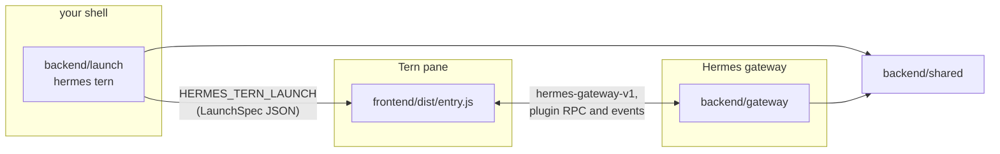

# Architecture

hermes-tern is a Hermes plugin with two halves: a TypeScript frontend that draws the chat in a Tern
pane, and a Python backend that Hermes loads. The Python runs in two different processes, so it is
split by process.

```
__init__.py              register(ctx): the plugin's one entry point; wires everything below
backend/
  launch/                hermes tern, in the user's shell, before and after the frontend
    launcher.py            flags, the session to open, LaunchSpec, runs node frontend/dist/entry.js
    panes.py               the pane's own conversation after its program died
  gateway/               loaded by Hermes' gateway, for every session it serves
    tern_env.py            the pane's TERN_* variables in each command the agent runs
    viewers.py             which pane shows which session (plugin RPC viewer.set / viewer.clear)
    pull_requests.py       link_pull_request, write_review_guide and the RPC the pane reads them from
    render_hints.py        the prompt section that says what Tern draws
    figure_check.py        checks a reply's mermaid and svg figures (re-runs itself under uv)
    charts.py              a background process's chart rules, from the auxiliary model
  shared/                reads both processes need
    sessions.py            Hermes' session database (read-only, through hermes_state)
    plugin_data.py         $HERMES_HOME/plugin-data/hermes-tern/
    processes.py           whether a pid runs, on every OS
frontend/                the chat UI (frontend/README.md maps its modules)
```



## Rules

- **`launch` and `gateway` never import each other.** They run in different processes, and a change
  to one should not reach the other. Both may import `shared`, which imports neither.
  `tests/test_layout.py` checks this, and that no module sits outside these folders.
- **Hermes is imported lazily**, inside the functions that need it, through the modules on its
  published plugin import list. Most tests run without a hermes-agent checkout.
- **The gateway half gets the plugin context only from `register(ctx)`.** A module that needs
  `ctx` later (a setting, an event to a session) gets a closure over it from its own `register`,
  as `charts.py`, `figure_check.py` and `pull_requests.py` do, not a module-level global.

## The seams

| Seam | Producer | Consumer | Contract |
| --- | --- | --- | --- |
| `HERMES_TERN_LAUNCH` | `backend/launch/launcher.py` `LaunchSpec` | `frontend/src/config/env.ts` `readLaunchEnv` | One JSON object, snake_case keys. A missing field or one of the wrong type reads as its empty value. |
| Plugin RPC `plugin.hermes-tern.*` | `backend/gateway/*` `ctx.register_rpc` | the frontend's gateway client | `viewer.set`, `viewer.clear`, `viewer.shown`, `pull_requests.linked`, `figures.check`, `charts.author`. |
| Plugin events | `ctx.emit_to_session` | the frontend | `pull_requests.changed`, `figures.checked`, `charts.authored`. |
| Pane files | the frontend | `backend/launch/panes.py` | `plugin-data/hermes-tern/panes/<TERN_PANE>.json`: the conversation a pane shows. |
| PR list files | the frontend | Tern's `prs` plugin | `panes/<pane>.prs.json`, in the format of `prs/README.md` in alt-glitch/tern-plugins. |
