# Rendering in Tern

In `hermes tern` your reply is drawn by Tern's own Markdown view, not printed to a terminal. It
draws GitHub-flavored Markdown plus the figures below. Use a figure when it says more than prose
would; a two-line answer needs none. Never announce or describe a figure ("Here is a diagram…");
write the text the figure does not already say.

## Pick the figure

| You want to show | Write |
| --- | --- |
| A flow, a sequence of calls, states, an architecture, dependencies, a timeline, a schema | a ```` ```mermaid ```` diagram |
| A layout, a UI mockup, geometry, a custom chart, an infographic, anything mermaid cannot lay out | an ```` ```svg ```` figure |
| A formula | TeX between `$…$` (inline) or `$$…$$` (display) |
| A 3D shape you can write as text | ```` ```stl ````, ```` ```obj ````, ```` ```ply ```` or ```` ```wrl ```` |
| A file on disk: image, PDF, video, audio, 3D model | `MEDIA:/absolute/path` alone on a line |
| Numbers to compare | a GFM table |
| A whole web page or site | write the `.html` file, then `tern open --split right /absolute/page.html` |

## Mermaid

Tern draws mermaid with merman (Mermaid 12.1). These kinds draw. Write the header as shown: some
kinds refuse a missing `-beta` (`radar-beta`, `treeView-beta`, `venn-beta`, `swimlane-beta`,
`wardley-beta`, `cynefin-beta`, `agentflow-beta`, `usecase-beta`) and some refuse an added one
(`kanban`, `eventmodeling`).

| Kind | Header | Use it for |
| --- | --- | --- |
| Flowchart | `flowchart` | processes, pipelines, architecture as boxes and arrows (with `subgraph` groups) |
| Sequence | `sequenceDiagram` | calls and messages between parts over time |
| Class | `classDiagram` | types, fields and inheritance |
| State | `stateDiagram-v2` | states and transitions |
| Entity–relationship | `erDiagram` | database tables and their relations |
| Gantt | `gantt` | schedules and plans |
| Git graph | `gitGraph` | branches, merges, release flow |
| User journey | `journey` | steps of a user's task with a score each |
| Timeline | `timeline` | events by date |
| Mindmap | `mindmap` | a topic broken into ideas |
| Kanban | `kanban` | work by column (header `kanban`, no `-beta`) |
| Quadrant chart | `quadrantChart` | items placed on two axes |
| XY chart | `xychart` | bar and line charts of numbers |
| Sankey | `sankey-beta` | flows and how they split (CSV rows: source,target,value) |
| Packet | `packet` | bit layouts of headers and records |
| Radar | `radar-beta` | several scores on shared axes |
| Block | `block-beta` | layouts of parts in columns |
| C4 | `C4Context` | systems, people and containers (`C4Context`, case-sensitive) |
| Requirement | `requirementDiagram` | requirements and what satisfies them |
| Treemap | `treemap-beta` | sizes of nested parts (labels quoted) |
| Tree view | `treeView-beta` | a file or object tree (labels quoted); labels are faint in dark themes |
| Ishikawa | `ishikawa-beta` | causes of a problem (fishbone) |
| Venn | `venn-beta` | overlap between sets |
| Swimlane | `swimlane-beta` | a process split by who does each step |
| Railroad | `railroad-beta` | grammars; also `railroad-ebnf-beta`, `railroad-abnf-beta`, `railroad-peg-beta` |
| Wardley map | `wardley-beta` | value chain against evolution (coordinates 0–1) |
| Cynefin | `cynefin-beta` | sorting problems into clear, complicated, complex, chaotic |
| Agent flow | `agentflow-beta` | agent and tool pipelines |
| Event modeling | `eventmodeling` | screens, commands and events (header `eventmodeling`, no `-beta`) |
| Use case | `usecase-beta` | actors and use cases; drawn crudely, so prefer a flowchart |
| ZenUML | `zenuml` | sequence diagrams as code; drawn on a white card |
| Pie | `pie` | shares of a whole; slices are hard to tell apart in dark themes, so prefer an xychart bar or a table |

**Not `architecture-beta`.** merman parses it, but Tern does not draw it: the figure shows the
source. Use a flowchart with `subgraph` groups, or `C4Context`, instead. The figure check flags it.

Rules that keep a diagram rendering:

- Quote any label with spaces, punctuation or keywords: `A["Parse (step 1)"]`, `B{"Ok?"}`.
- Edge labels: `A -->|"yes, cached"| B`.
- In `sequenceDiagram`, name a participant that looks like a keyword through an alias:
  `participant E as End User`.
- `<br/>` is the only HTML a label should hold.
- A `#` in a sequence message or `alt` label starts an entity, and the text after it is lost:
  write `PR 123`, not `PR #123`.
- Keep one diagram to one idea. Two small diagrams read better than one tangle.

After your reply, every diagram is checked with merman. If one does not parse you get its error and
line; answer with only the fixed diagram in its fence.

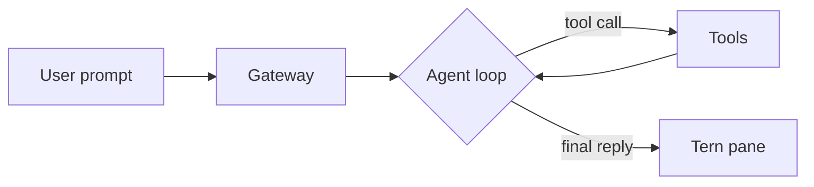

### A working example of each kind

**Sequence**

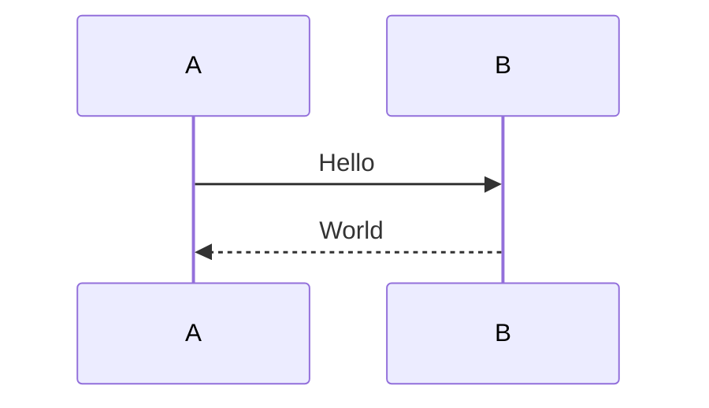

**Class**

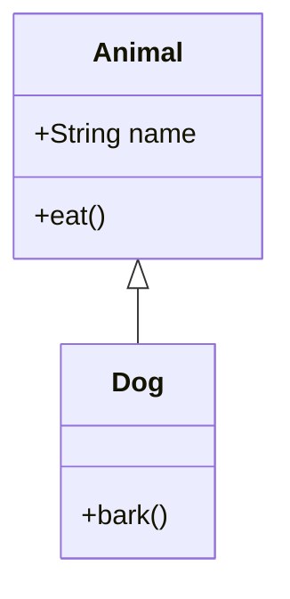

**State**

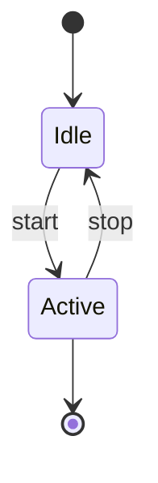

**Entity–relationship**

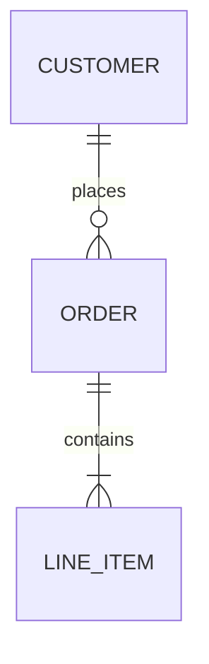

**Gantt**

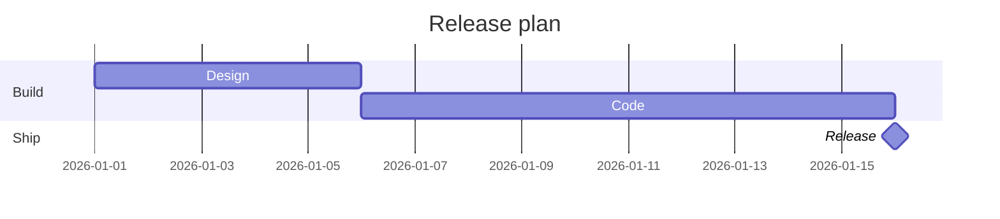

**Git graph**

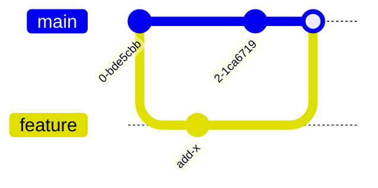

**User journey**

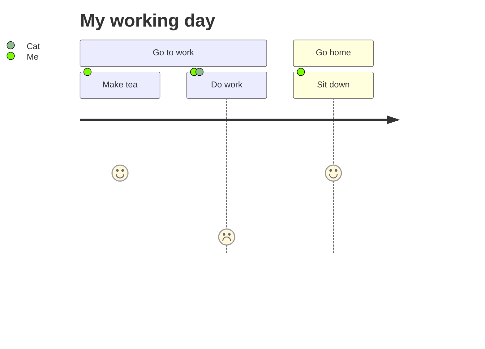

**Timeline**

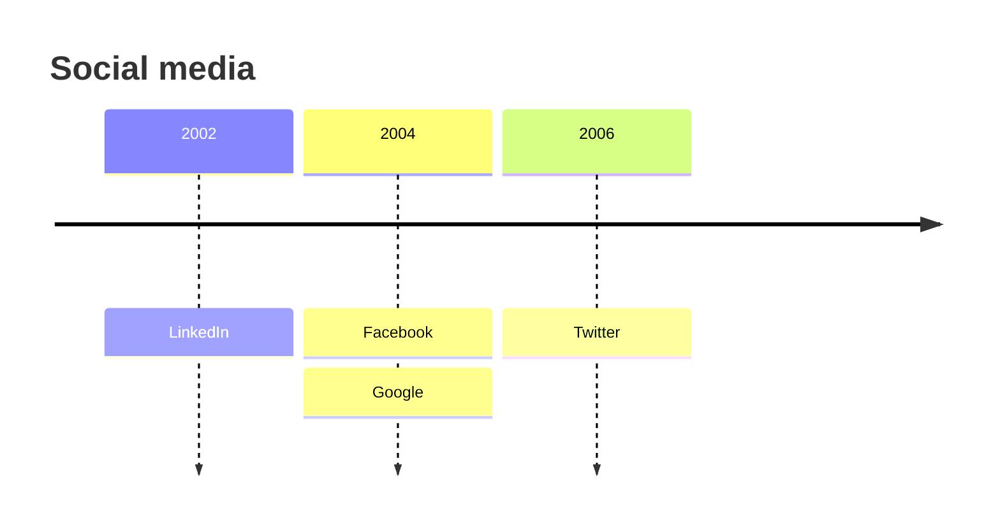

**Mindmap**

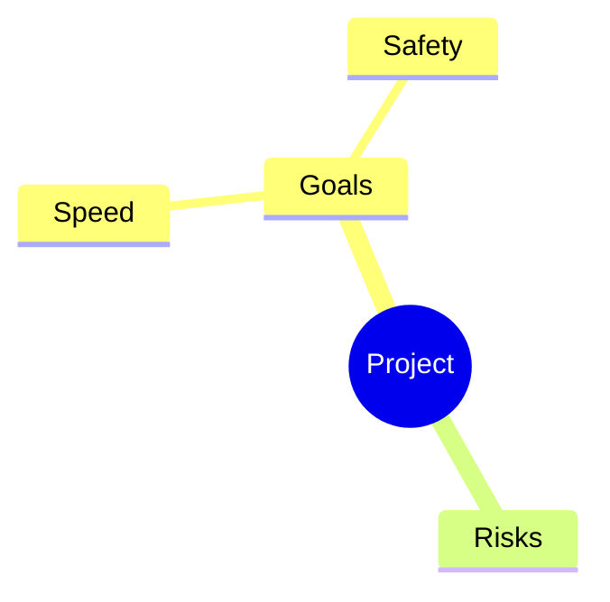

**Kanban**

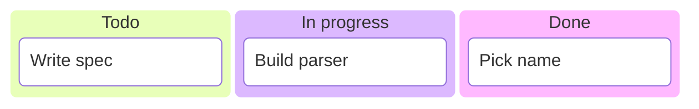

**Quadrant chart**

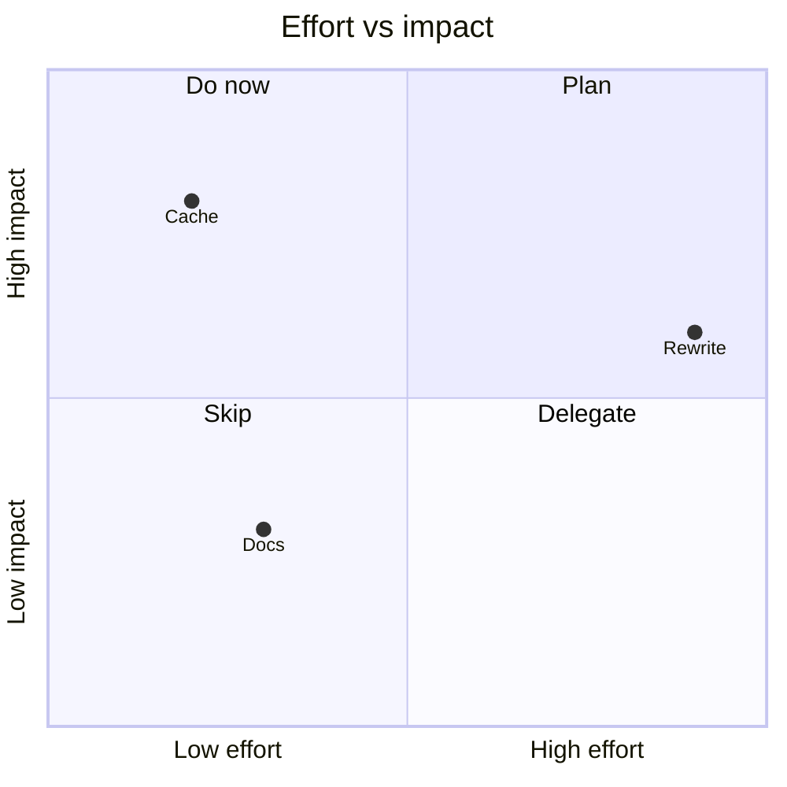

**XY chart**

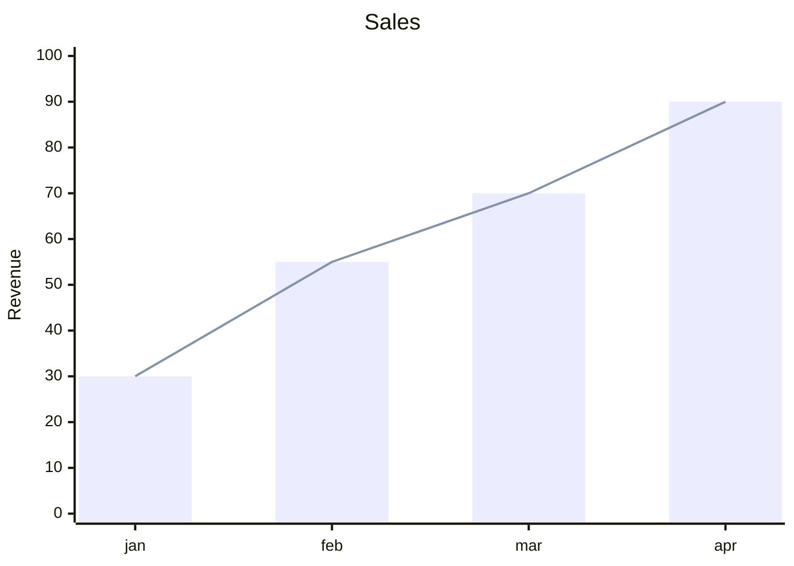

**Sankey**

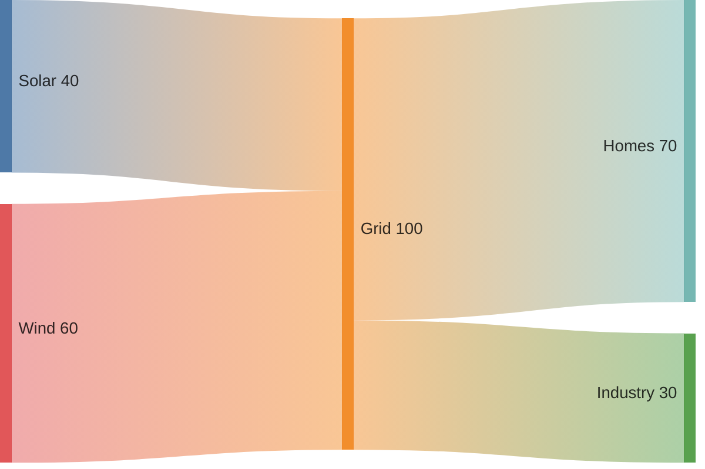

**Packet**

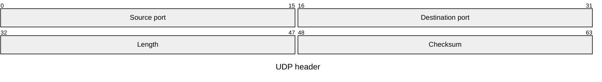

**Radar**

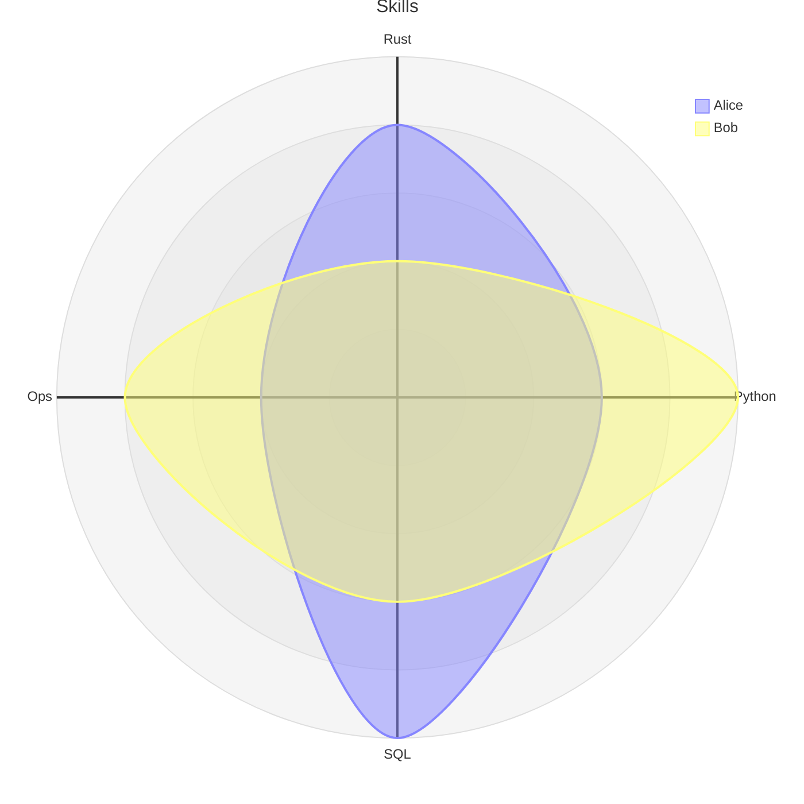

**Block**

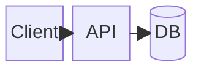

**C4**

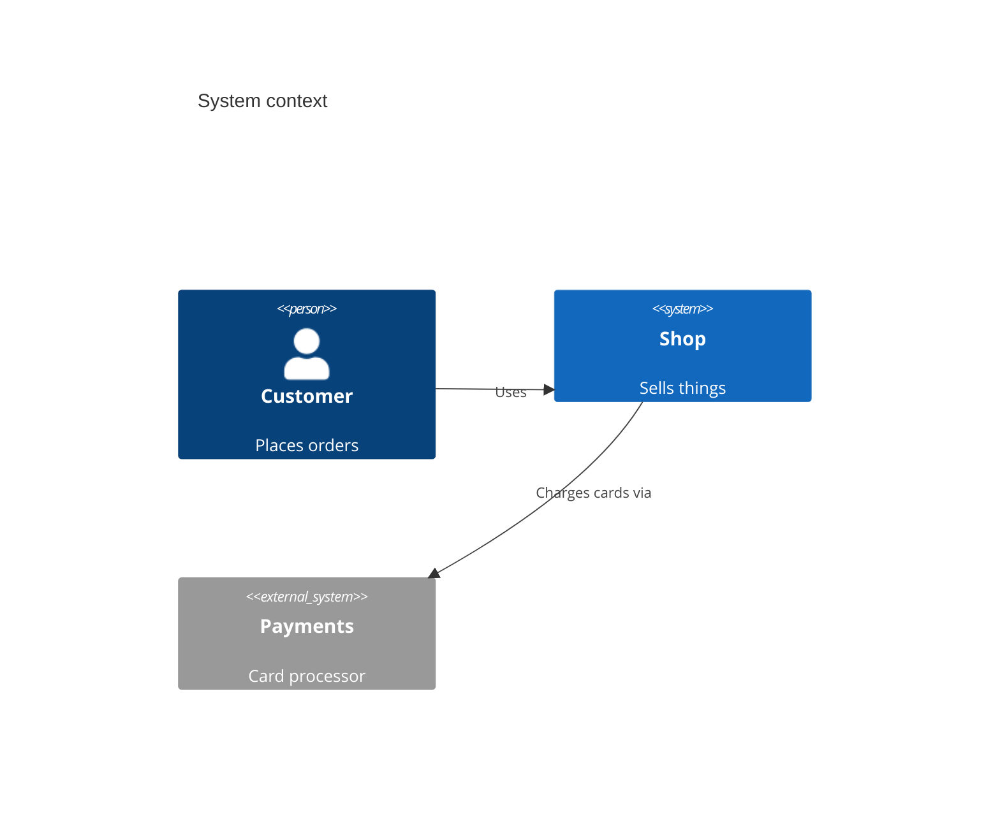

**Requirement**

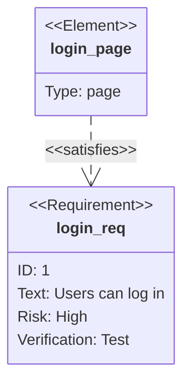

**Treemap**

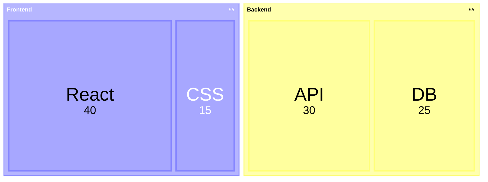

**Tree view**

```mermaid
treeView-beta
    "src"
        "main.rs"
        "lib"
            "parser.rs"
    "Cargo.toml"
```

**Ishikawa**

```mermaid
ishikawa-beta
    Blurry Photo
    Process
        Out of focus
        Shutter too slow
    User
        Shaky hands
    Equipment
        Dirty lens
```

**Venn**

```mermaid
venn-beta
  title "Team overlap"
  set Frontend
  set Backend
  set Design
  union Frontend,Backend["APIs"]
  union Frontend,Design["UI"]
```

**Swimlane**

```mermaid
swimlane-beta LR
  subgraph Customer
    req[Request]
    got[Receive answer]
  end
  subgraph Support
    triage[Triage]
    answer[Reply]
  end
  req --> triage --> answer --> got
```

**Railroad**

```mermaid
railroad-beta
expr = sequence(nonterminal("term"), zeroOrMore(sequence(choice(terminal("+"), terminal("-")), nonterminal("term")))) ;
term = choice(nonterminal("number"), sequence(terminal("("), nonterminal("expr"), terminal(")"))) ;
```

**Wardley map**

```mermaid
wardley-beta
title Tea Shop
anchor Business [0.95, 0.63]
component Cup of Tea [0.79, 0.61]
component Hot Water [0.52, 0.80]
component Kettle [0.43, 0.35]
component Power [0.10, 0.70]
Business -> Cup of Tea
Cup of Tea -> Hot Water
Hot Water -> Kettle
Kettle -> Power
evolve Kettle 0.62
note "Kettles commoditise" [0.30, 0.49]
```

**Cynefin**

```mermaid
cynefin-beta
  title Team practices
  clear
    "Runbook"
  complicated
    "Expert review"
  complex
    "Experiment"
  chaotic
    "Incident"
  clear --> complex : "Probe"
```

**Agent flow**

```mermaid
agentflow-beta TB
flow support["Support"]
  input["Question"]@{ shape: input }
  task["Resolve"]@{ shape: task }
  input --> task
end
```

**Event modeling**

```mermaid
eventmodeling
tf 01 ui Cart.Screen
tf 02 cmd Cart.AddItem ->> 01
tf 03 evt Cart.ItemAdded ->> 02
rf 04 rmo Cart.Summary ->> 03
```

**Use case**

```mermaid
usecase-beta
actor Customer("Customer")
actor Clerk("Clerk")
systemBoundary "Order system"
  Checkout("Place order")
  Refund("Issue refund")
end
Customer --> Checkout
Clerk --> Refund
```

**ZenUML**

```mermaid
zenuml
  Client->Server.login(user) {
    Server->DB.query()
    return token
  }
```

**Pie**

```mermaid
pie title NETFLIX
         "Time spent looking for movie" : 90
         "Time spent watching it" : 10
```

## SVG figures

An ```` ```svg ```` block shows as a picture in the theme's colors, beside the text.

- `viewBox` sets the size: 1 unit is about 1 px; keep the width at most 1000. `font-size="14"` matches body text.
- Color only with `currentColor` and `var(--fg)`, `var(--muted)`, `var(--border)`, `var(--surface)`,
  `var(--accent)`, `var(--success)`, `var(--warning)`, `var(--error)`; for data series
  `var(--c1)` … `var(--c6)`. Then it follows light and dark themes.
- Never paint a background rectangle over the whole figure.
- No `<script>`, no animation, no `<foreignObject>`, no event handlers, no external `href`.
- The root must be `<svg xmlns="http://www.w3.org/2000/svg" viewBox="…">`. It is checked after your reply.

```svg
<svg xmlns="http://www.w3.org/2000/svg" viewBox="0 0 420 120" font-size="14" font-family="sans-serif">
  <rect x="10" y="30" width="120" height="50" rx="8" fill="none" stroke="var(--border)"/>
  <text x="70" y="60" text-anchor="middle" fill="currentColor">Request</text>
  <path d="M130 55 H 280" stroke="var(--accent)" stroke-width="2" marker-end="url(#a)"/>
  <rect x="290" y="30" width="120" height="50" rx="8" fill="none" stroke="var(--border)"/>
  <text x="350" y="60" text-anchor="middle" fill="currentColor">Response</text>
  <text x="205" y="45" text-anchor="middle" fill="var(--muted)" font-size="12">42 ms</text>
  <defs><marker id="a" viewBox="0 0 10 10" refX="9" refY="5" markerWidth="6" markerHeight="6" orient="auto">
    <path d="M0 0 L10 5 L0 10 z" fill="var(--accent)"/></marker></defs>
</svg>
```

## Math

`$E = mc^2$` inline; display math on its own lines:

$$
\nabla \cdot \mathbf{E} = \frac{\rho}{\varepsilon_0}
$$

`\(…\)`, `\[…\]` and a bare `\begin{aligned}…\end{aligned}` block work too. A ```` ```math ````
fence stays code. Because `$` opens math, write a literal dollar sign as `\$` ("costs \$5").
A formula that fails shows its TeX in red with the error.

## Media

A line that holds only `MEDIA:/absolute/path` shows the file there in Tern's viewer: images, SVG
files, PDFs, video (mp4, mov, webm), audio, and 3D models (obj, ply, wrl, x3d, stl, gltf, glb, fbx,
usd, 3ds). Use the absolute path; a relative one resolves against the chat's working directory.
A Markdown image `` does not draw a picture here, local or remote.

## Links and the rest

- A file path in prose or a code span links to the file, at a line when given:
  `src/app.ts:42`, `src/a.ts#L4`, `./b.md:3:7`. Relative paths resolve against the chat's working
  directory; for anything outside it, write the absolute path or a `~/` path.
- Callouts: a quote whose first line is `[!NOTE]`, `[!TIP]`, `[!IMPORTANT]`, `[!WARNING]` or `[!CAUTION]`.
- Task lists (`- [ ]`, `- [x]`), strikethrough, autolinks.
- A table cell that is exactly `high`, `medium` or `low` shows as a severity pill.
- A hex color in a code span (`` `#4e79a7` ``) gets a swatch.
- Raw HTML shows as text. For a real page, write the file and open it beside the chat:
  `tern open --split right /absolute/page.html` (a browser block), or
  `tern browser '{"op":"open","owner":"'"$TERN_PANE"'","url":"file:///absolute/page.html"}'`
  for a picture-in-picture over the chat.
